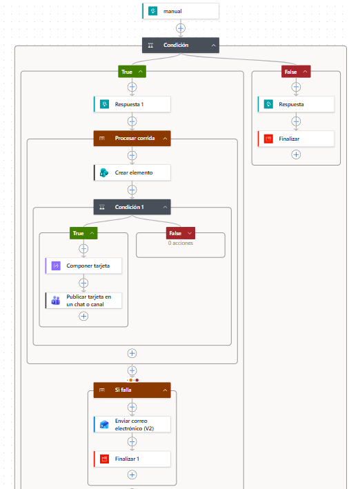
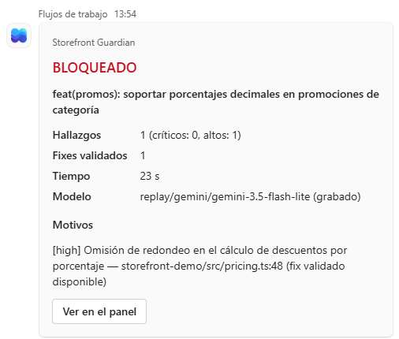
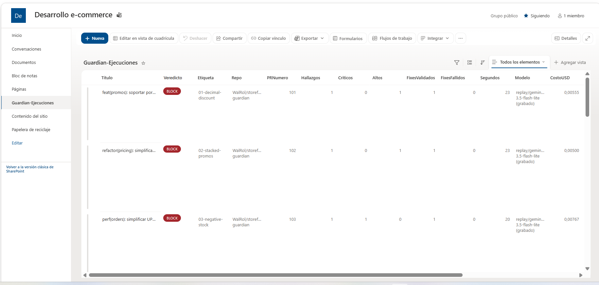
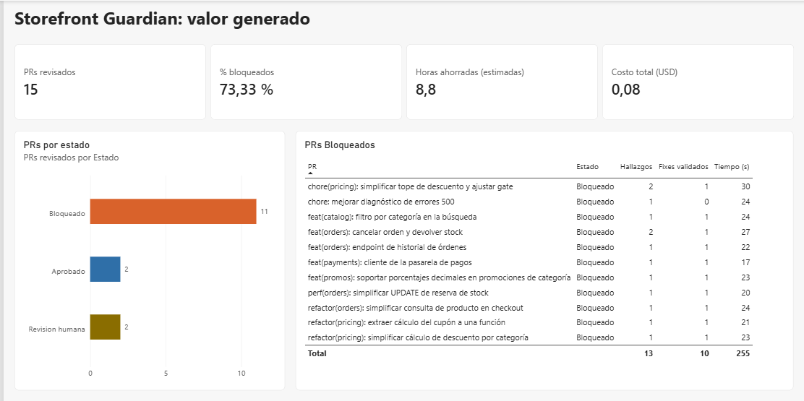

# Integración con Power Platform: Power Automate, SharePoint, Teams y Power BI

El mismo webhook que alimenta a [n8n](../n8n/README.md) alimenta un flujo de Power Automate. **No cambia el
código del agente**: Guardian emite un evento por corrida y el flujo lo consume.

- Cada corrida queda registrada en una **lista de SharePoint**.
- El equipo recibe una **tarjeta en Teams** solo cuando tiene que actuar (BLOQUEADO o REVISIÓN HUMANA). Un PR
  aprobado no avisa a nadie: un bot que hace ruido se ignora.
- Si el registro falla, un bloque de manejo de errores **avisa por correo** con el link exacto a la ejecución.
- Sobre la lista, un reporte de **Power BI** muestra el valor generado.

```
Guardian ──POST + X-Guardian-Token──▶ Power Automate (trigger HTTP)
                                         ├─ token inválido → 401 y termina
                                         └─ token válido → 202 (Guardian no espera el resto)
                                              ├─ Procesar corrida (try)
                                              │    ├─ Crear elemento en SharePoint (siempre)
                                              │    └─ ¿veredicto ≠ APPROVE? → tarjeta en Teams
                                              └─ Si falla (catch) → correo con el link a la ejecución
                                                                  → la ejecución queda "Con errores"
```

## Capturas

Se construyó en un tenant de prueba de Microsoft 365, así que el flujo y el reporte no son accesibles desde
afuera. Esta es la evidencia:

| | |
|---|---|
| Flujo en Power Automate |  |
| Tarjetas en Teams |  |
| Lista de SharePoint |  |
| Reporte de Power BI |  · [PDF](guardian-valor.pdf) |

Los datos son los 15 casos del eval corridos en modo replay con [poblar-corridas.ps1](poblar-corridas.ps1).

## Decisiones

| Decisión | Por qué |
|---|---|
| Responder 202 antes de procesar | Guardian espera 10 s como máximo. El registro y el aviso no deben frenar el pipeline. |
| Token en un header, además de la URL firmada | Segunda capa: una URL filtrada sola no alcanza para escribir en la lista. |
| Entradas y salidas seguras en el trigger | El token y el contenido no quedan visibles en el historial de ejecuciones. |
| La tarjeta se arma en una acción *Redactar* | Interpolar el JSON a mano en la acción de Teams se rompe si un título o un motivo trae comillas. |
| Avisar solo si el veredicto no es APPROVE | Cada aviso tiene que pedir una acción. |
| Ámbitos *try/catch* + *Finalizar con errores* | Sin el *Finalizar*, el *catch* termina bien y la ejecución figura como correcta aunque el registro haya fallado. |
| Horas "estimadas" en Power BI | Salen de los supuestos de `guardian.policy.yaml` (15 min por revisión + 30 por fix validado). Validarlos con datos reales es el paso siguiente. |

En producción, el token iría en una variable de entorno de la solución o en Azure Key Vault, no escrito en la
condición del flujo. Por la misma razón el flujo no se exporta como paquete en este repo: llevaría el token adentro.

## Cómo replicarlo

### Requisitos

- Una cuenta de trabajo o escolar con SharePoint, Teams y Power Automate. Por ejemplo, la prueba de
  Microsoft 365 Business Basic.
- El trigger HTTP es **premium**. El [Power Apps Developer Plan](https://powerapps.microsoft.com/developerplan)
  es gratis y crea un entorno de tipo *Desarrollador* donde funciona. Construye el flujo en ese entorno.
- Power BI Desktop (gratis) para el reporte.

### 1. Lista de SharePoint "Guardian-Ejecuciones"

| Columna | Tipo | Campo del evento |
|---|---|---|
| Title | Una línea de texto | `pr.title` |
| Veredicto | Elección: APPROVE, REVIEW, BLOCK | `verdict` |
| Etiqueta, Repo, Modelo | Una línea de texto | `label`, `repo`, `model` |
| PRNumero, Hallazgos, Criticos, Altos, FixesValidados, FixesFallidos, Segundos, MinutosAhorrados | Número | `pr.number`, `counts.*`, `seconds`, `minutesSavedEstimate` |
| CostoUSD | Número (5 decimales) | `costUsd` |
| FechaCorrida | Fecha y hora | `at` |
| Motivos | Varias líneas de texto | `reasons`, unidos |

### 2. Flujo de nube automatizado

1. **Trigger "Cuando se recibe una solicitud HTTP"**, con el esquema de [esquema-evento.json](esquema-evento.json).
   Activa entradas y salidas seguras cuando termines de probar.
2. **Condición** `triggerOutputs()?['headers']?['X-Guardian-Token']` es igual al token.
   - No: **Respuesta** 401 → **Finalizar** (Cancelado).
   - Sí: **Respuesta** 202 → ámbito **Procesar corrida** → ámbito **Si falla**.
3. **Procesar corrida**:
   - **Crear elemento** en la lista, campo por campo con `triggerBody()?[...]`. Tres campos necesitan expresión:
     `coalesce(triggerBody()?['repo'], 'local')`, `triggerBody()?['pr']?['number']` y
     `join(triggerBody()?['reasons'], decodeUriComponent('%0A'))`.
   - **Condición** `verdict` no es igual a `APPROVE` → **Redactar** con [tarjeta-teams.json](tarjeta-teams.json) →
     **Publicar tarjeta en un chat o canal** (Bot de flujo), con las salidas de *Redactar*.
4. **Si falla**, configurado para ejecutarse después de que *Procesar corrida* **tenga errores** o **agote el tiempo
   de espera**: **Enviar un correo (V2)** con el link a la ejecución
   (`concat('https://make.powerautomate.com/environments/', workflow()?['tags']?['environmentName'], '/flows/', workflow()?['name'], '/runs/', workflow()?['run']?['name'])`)
   → **Finalizar** (Con errores).

Las expresiones se insertan con el botón **fx**. Pegadas como texto, Power Automate no las evalúa.

### 3. Probar y cargar datos

En PowerShell, desde la raíz del repo y después de `npm run setup`:

```powershell
$env:PA_URL = '<URL del trigger>'; $env:PA_TOKEN = '<token>'
.\docs\power-platform\probar-webhook.ps1                 # 202: fila nueva y tarjeta
.\docs\power-platform\probar-webhook.ps1 -TokenInvalido  # 401: nada nuevo
.\docs\power-platform\poblar-corridas.ps1                # los 15 casos en modo replay
.\docs\power-platform\demo-en-vivo.ps1                   # un caso, con el avance por etapa
```

Las variables de la sesión tienen prioridad sobre el `.env`, así que no hace falta tocarlo.

### 4. Reporte de Power BI

Power BI Desktop → **Lista de SharePoint Online** (implementación 2.0, vista Predeterminado). Renombra la tabla
importada a `Corridas` para que las medidas funcionen tal cual:

```
PRs revisados = COUNTROWS(Corridas)
Porcentaje bloqueados = DIVIDE(CALCULATE([PRs revisados], Corridas[Veredicto] = "BLOCK"), [PRs revisados])
Horas ahorradas (estimadas) = DIVIDE(SUM(Corridas[MinutosAhorrados]), 60)
Costo total USD = SUM(Corridas[CostoUSD])
```

Página: cuatro tarjetas, barras por estado y una tabla con los PRs bloqueados.
